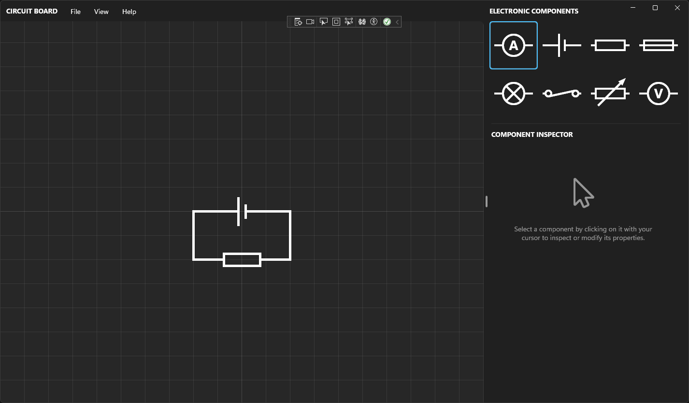



# CircuitSim

CircuitSim is an electrical circuit simulation program made for my A-level Computer Science coursework.

## Project Status

- Stage 1 — Basic Circuit Simulation
	- [x] Create basic circuit element classes
	- [x] Implement Modified Nodal Analysis
	- [x] Create circuit board class to contain elements
- Stage 2 — Basic Circuit Building UI
	- [x] Implement UI elements for circuit boards
	- [x] Circuit editor input for adding/removing components
- Stage 3 — Advanced Circuit Editing
	- [ ] Component inspector UI & input for selecting components
	- [ ] Implement other components
- Stage 4 — Circuit Board Saving/Loading
	- [ ] Circuit board serialisation & deserialisation
	- [ ] Saving & loading circuit boards from files
- Stage 5 — Exam-Style Question Generation
	- [ ] Question generation (ask for a hidden quantity in a circuit)
	- [ ] Main menu for configuring question generation
